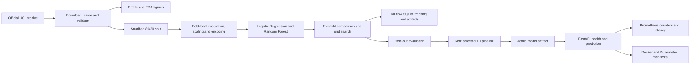
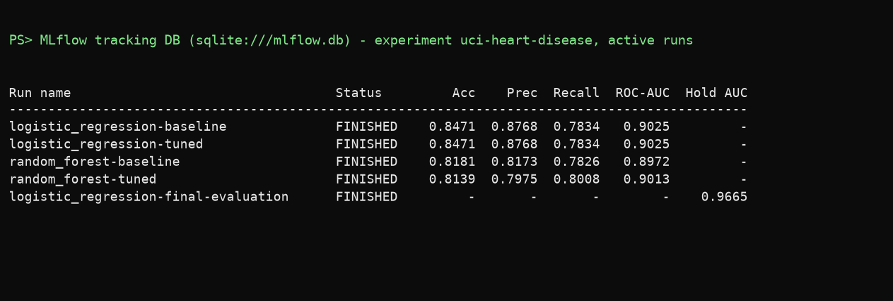
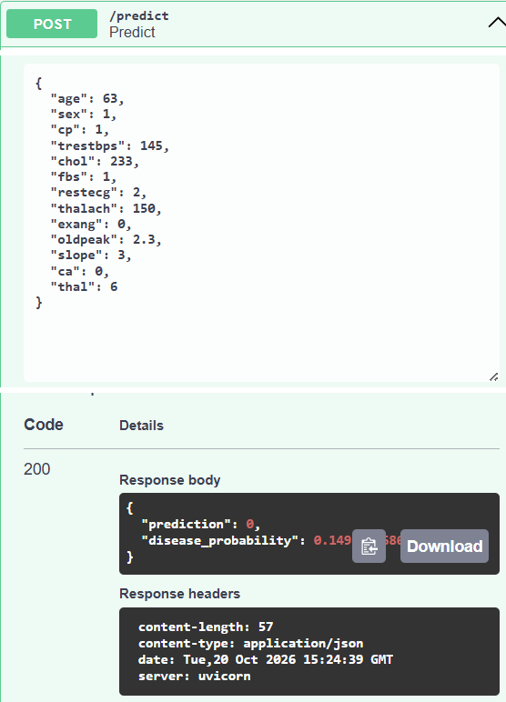
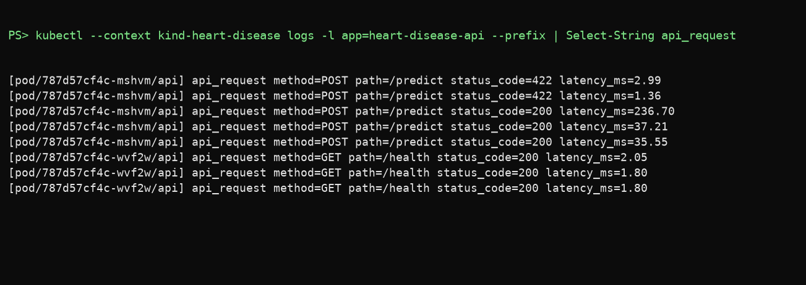

# Heart Disease Classification: MLOps Project Report

## Abstract

This report documents a reproducible binary-classification workflow built on the
processed Cleveland subset of the UCI Heart Disease dataset. The implementation
acquires and profiles source data, compares Logistic Regression and Random Forest
pipelines, tunes them using stratified cross-validation, logs run metadata and model
artifacts in MLflow, evaluates a held-out sample, and exports a fitted preprocessing
and model pipeline. A FastAPI service exposes predictions and health status, while
Prometheus metrics support basic operational visibility. Tests, linting, and model
training are connected through GitHub Actions.

The measured results are educational and are not clinical validation. The small,
historical Cleveland sample cannot support claims about present-day patients or other
populations. Cloud deployment and video capture are described as outstanding manual
steps because no cloud credentials or recording artifact were supplied.

## 1. Problem and scope

The prediction task is to distinguish records indicating the presence of angiographic
heart disease from records indicating its absence. The source outcome, `num`, has
values zero through four. This implementation converts it to a binary label: zero
maps to class 0 and values one through four map to class 1. The probability returned
by the service is the selected model's estimated probability for class 1; it is not a
patient's probability of a future heart attack, a causal estimate, or a diagnosis.

The engineering objective is to maintain one pipeline definition from training
through serving. Data-dependent operations are fitted inside scikit-learn pipelines
so that cross-validation does not fit imputers, scalers, or category encoders using
validation-fold rows. Training is repeatable through fixed random seeds and an
explicit stratified split. Model comparison, tuning, held-out evaluation, artifact
creation, and service contracts are separate and testable components.

This project is a portfolio and workflow example. It does not establish clinical
utility, safety, or regulatory suitability. A deployment must not be used to make
care decisions. The data lack the scale, recency, population breadth, and prospective
design needed for clinical use. Any such use would require domain-owner review,
external validation, privacy and security assessment, calibrated risk estimates,
human oversight, and an approved regulatory pathway.

## 2. Data source and preparation

The source is the processed Cleveland file from the UCI Machine Learning Repository's
Heart Disease dataset. The official UCI page describes four source databases and
identifies Cleveland as the subset used by most published experiments. It records
303 rows, 13 predictors, missing values, and an ordinal diagnosis. The source, DOI,
license, citation, and official archive URL are recorded in [data/SOURCE.md](../data/SOURCE.md).
The dataset DOI is 10.24432/C52P4X and its listed license is CC BY 4.0.

The downloader fetches the official zip archive and extracts only
`processed.cleveland.data`. It does not unpack arbitrary archive members to disk. The
loader assigns explicit column names, translates `?` to missing values, coerces each
column to numeric, checks the expected 14-column shape, rejects missing targets, and
maps the diagnosis to the binary label. The original predictor values are preserved;
missing predictors are not imputed in the loader.

Running `python -m heart_disease.data` writes the named, binary-labeled table to
`data/processed/cleveland_cleaned.csv`. The original four-level `target_original`
column is replaced with `target`; missing predictor entries remain blank in the CSV
so imputation is still learned inside each training fold. This processed file is
included as a reproducible assignment deliverable.

The dataset is small enough that all six missing predictor values can be inspected
directly. Four values are missing in `ca` and two in `thal`; no other feature or target
values are missing. The two affected features are categorical for the modeling
pipeline. Their imputers are fitted on each training fold, not across the complete
dataset. This preserves the missingness information in the EDA output while keeping
the evaluation procedure leakage-aware.

## 3. Exploratory analysis

The generated profile reports 303 rows and 13 predictors. The target distribution is
164 class-0 records and 139 class-1 records, or approximately 54.1% and 45.9% of the
sample. This is not a large imbalance, but both stratified splitting and stratified
cross-validation are retained so each evaluation fold has a representative class
mix. Predictor dtypes are reported in `reports/data_profile.json`; source values are
read as numeric, while the feature roles used in the model are declared separately.

The numeric histograms make the distributions and value ranges reviewable. The
correlation heatmap is a descriptive pairwise view of numerically encoded variables;
it should not be read as evidence of causal relationships. The class-balance chart
shows the absolute count per binary label. Together, these plots are useful for
detecting obvious data problems and communicating dataset composition, not for
selecting a clinical threshold or establishing scientific hypotheses.

## 4. Architecture

Data acquisition, EDA, model construction, training, and API code are separated into
modules under `src/heart_disease/`. The package structure lets a developer execute a
stage directly while retaining a single canonical loader and pipeline definition.
Generated metrics and figures go to `reports/`, the selected deployable artifact goes
to `models/`, and MLflow metadata is stored in SQLite with artifacts under
`mlartifacts/` by default.

The preprocessing object is serialized with the estimator. The API therefore accepts
the original 13 feature fields and applies the exact learned transformations used at
training time. It does not independently recreate category encodings or scaling
rules. The service records only aggregate predicted-class counts and latency; it does
not record patient feature values in application logs or custom metrics.

## 5. Preprocessing and model development

The five continuous measurements are age, resting blood pressure, serum cholesterol,
maximum heart rate, and ST depression. Each uses median imputation followed by
standard scaling. The remaining eight fields are treated as categorical: sex, chest
pain type, fasting blood-sugar flag, resting ECG, exercise-induced angina, ST slope,
number of vessels, and thal result. These use most-frequent imputation and one-hot
encoding with unknown-category tolerance. The categorical values are not treated as
equally spaced numeric quantities by the models.

The first candidate is Logistic Regression with a `liblinear` solver, a fixed random
seed, and a high iteration ceiling. The second is a Random Forest with a fixed seed
and a single worker for reliable local and CI execution. Candidate pipelines share
the same preprocessing transformer. This makes the estimator comparison meaningful
and makes the selected output directly deployable.

The Logistic Regression search evaluates regularization strengths of 0.01, 0.1, 1,
and 10. The Random Forest search evaluates 100 or 250 trees, unlimited depth or
maximum depths of 5 or 10, and minimum leaf sizes of 1, 2, or 4. Both use the same
five stratified folds and report accuracy, precision, recall, and ROC-AUC. ROC-AUC is
the predeclared selection metric; the held-out set does not participate in tuning.

## 6. Validation protocol and results

Before cross-validation, the full labeled data are divided into an 80% training
partition and a 20% held-out partition using stratification and seed 42. Candidate
comparison and grid search use only the training partition. For each candidate, the
baseline pipeline is evaluated with stratified five-fold cross-validation; the
selected parameter configuration is then measured with the same folds. Means and
standard deviations are written to the metrics JSON and comparison CSV.

| Model and stage | CV accuracy | CV precision | CV recall | CV ROC-AUC |
|---|---:|---:|---:|---:|
| Logistic Regression, baseline | 0.8471 | 0.8768 | 0.7834 | 0.9025 |
| Logistic Regression, tuned | 0.8471 | 0.8768 | 0.7834 | 0.9025 |
| Random Forest, baseline | 0.8181 | 0.8173 | 0.7826 | 0.8972 |
| Random Forest, tuned | 0.8139 | 0.7975 | 0.8008 | 0.9013 |

Logistic Regression was selected because its tuned mean cross-validation ROC-AUC was
the highest at 0.9025. The Random Forest tuned mean was 0.9013, close enough that the
difference should not be interpreted as proof of meaningful superiority. The
Logistic Regression search selected `C=1.0`, so the tuning result matches the
baseline parameterization. Random Forest tuning slightly increased recall while
reducing accuracy and precision in these folds.

The selected tuned estimator was evaluated once on the 61-row held-out partition.
It achieved accuracy 0.8852, precision 0.8387, recall 0.9286, and ROC-AUC 0.9665.
These are point estimates from one small split and can vary substantially with the
sample. The ROC curve and confusion matrix are generated from this evaluation. After
the holdout scores were computed, the selected preprocessing-plus-model pipeline was
refit on all 303 rows and exported for service use. Thus, the final artifact is not
the same fitted object that generated the holdout measurements.

| Selected model | Holdout accuracy | Holdout precision | Holdout recall | Holdout ROC-AUC |
|---|---:|---:|---:|---:|
| Logistic Regression, tuned (`C=1.0`) | 0.8852 | 0.8387 | 0.9286 | 0.9665 |

## 7. Experiment tracking and reproducibility

MLflow uses the `uci-heart-disease` experiment and a local SQLite backend by default.
Each baseline and tuned candidate run stores model identity, stage, tuned parameters
when applicable, four cross-validation metric means, the metric summary JSON, and a
joblib pipeline artifact. A final evaluation run stores held-out metrics, the selected
pipeline artifact, metrics JSON, and generated plots. SQLite is used instead of the
legacy filesystem tracking store, which current MLflow rejects by default.

The table above is rendered from the SQLite tracking database rather than from the
MLflow web page, because the MLflow interface could not be captured legibly in the
available browser. It lists the five active runs and their logged metrics.

The joblib files are generated locally from the project's own pipeline objects and
logged as run artifacts. They are not loaded through MLflow's sklearn flavor, avoiding
a broad trust exception for scikit-learn's native Random Forest tree storage. As with
any pickle-based format, joblib artifacts must only be loaded from a trusted source.
The serving container builds from the artifact produced by this training workflow.

Seeds are fixed for the split, cross-validation folds, and estimators. The data source
is documented, and the generated profile, metrics, model comparison, figures, and
tracked run artifacts make the result reviewable. Dependency versions are not fully
pinned in this initial setup; long-term reproductions should use a lock file or
versioned environment and should record the dataset archive checksum and code commit
with each approved run. A remote MLflow server can be configured with
`MLFLOW_TRACKING_URI` when its database and artifact store are provisioned.

## 8. Serving, deployment, and monitoring

The FastAPI application has three operational routes. `GET /health` returns success
only when the model artifact was loaded; absence of the model returns HTTP 503.
`POST /predict` validates all 13 expected inputs, rejects unexpected fields, and
returns a binary class plus positive-class probability. `GET /metrics` exposes
Prometheus request counters by predicted class and a prediction-latency histogram.
The contract tests exercise the endpoint response, readiness, invalid inputs, and
metrics route.

The Dockerfile uses Python 3.12 slim, installs only the API runtime dependencies,
includes the selected model, and runs as a non-root user. The image
`heart-disease-api:local` built successfully at 691,290,174 bytes. It was run on host
port 8001; health returned HTTP 200, the synthetic example returned class 0 with
probability 0.1498261687, and metrics returned HTTP 200 with prediction and latency
series. Container logs showed the health, prediction, and metrics requests.

The API writes one `api_request` log line per request containing the method, path,
status code, and latency in milliseconds; request bodies and patient values are not
logged. Verifying the deployed pods showed that these lines were initially missing,
because uvicorn does not configure application loggers. A stream handler was added to
the API logger, the image was rebuilt, and the lines now appear in container and pod
logs.

A one-node kind v1.37.0 cluster was created with context `kind-heart-disease`. The
image was loaded into the node, and the Kubernetes Deployment and ClusterIP Service
were applied. The rollout completed with two of two replicas ready and no restarts.
The Service was forwarded to host port 8002 and passed the same health, prediction,
and metrics checks. The Swagger capture below is a real `/predict` call against the
Kubernetes Service, and the pod-log capture is rendered from the actual `kubectl logs`
output. The remaining captures (Docker image and container, deployment status,
metrics, health, and the second Swagger view) are in `screenshots/` and indexed in
`reports/local_api_evidence.md`.

No cloud provider, registry, account, or deployment secret was supplied, so this is a
local Kubernetes deployment, not a public-cloud deployment. The local setup also does
not provide TLS, authentication, or production monitoring. A short demonstration
video still needs to be recorded by the student from this local deployment; the
screenshots and evidence table are not represented as a video.

## 9. CI, quality, and limitations

The GitHub Actions workflow installs Python 3.12 and runs Ruff, the unit and API
contract tests, and the full training pipeline. It uploads the selected model,
evaluation JSON/CSV, plots, and MLflow database/artifacts. Local validation completed
with five passing tests and a clean Ruff check. Training completed successfully and
generated the results in this report. The installed FastAPI/Starlette test client
emits a deprecation warning about the current `httpx` integration; this is not a test
failure, but the dependency combination should be reviewed during upgrades.

The dataset is only 303 historical records from one source cohort. It is vulnerable
to sampling bias, shifts in clinical practice, missing-data assumptions, coding
differences, and population changes. The split-derived scores are not a substitute
for external validation, calibration analysis, uncertainty estimates, subgroup
evaluation, threshold selection with domain experts, prospective testing, or temporal
validation. Precision and recall also depend on the chosen classification threshold.

The service is a technical example, not a medical device. Before real use, the
organization would need clinical governance, privacy review, access control, secure
transport, audit and incident procedures, data retention controls, model approval,
and documented human oversight. Monitoring currently measures service availability
and aggregate prediction traffic; it does not monitor data drift, labels, clinical
outcomes, calibration, or fairness. Those require approved, privacy-aware data and
additional operational design.

## 10. Conclusion and next steps

The checklist's data, EDA, model development, experiment tracking, artifact saving,
unit tests, API, CI, architecture/report, and local deployment preparation now have
concrete implementations. The measured comparison selects Logistic Regression by
mean cross-validation ROC-AUC, while the holdout provides a separate, explicitly
limited estimate. The trained pipeline is saved at
`models/heart_disease_pipeline.joblib`, and MLflow contains metrics and model
artifacts for candidate runs.

The local image and kind deployment have been built, exercised, and documented. The
remaining submission work is to publish to a public cloud if required, record the
short end-to-end video, push the project to the student's own GitHub repository, and
review the hosted Actions run. Before final submission, preserve the MLflow artifacts
and add a lock file and source-data checksum if strict reproducibility is required.